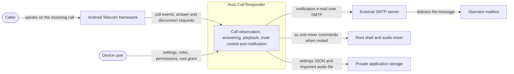
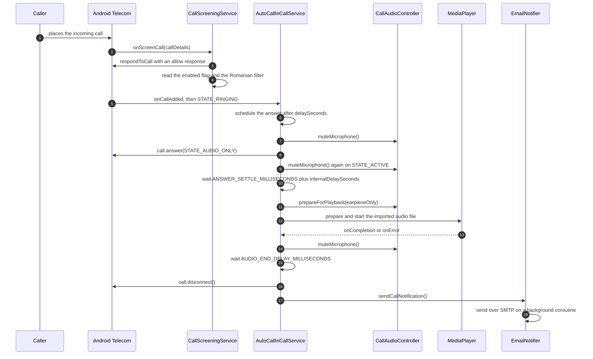
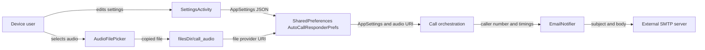
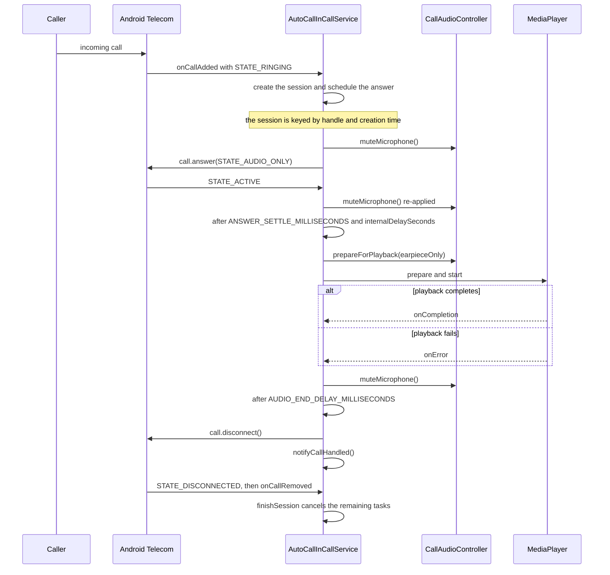
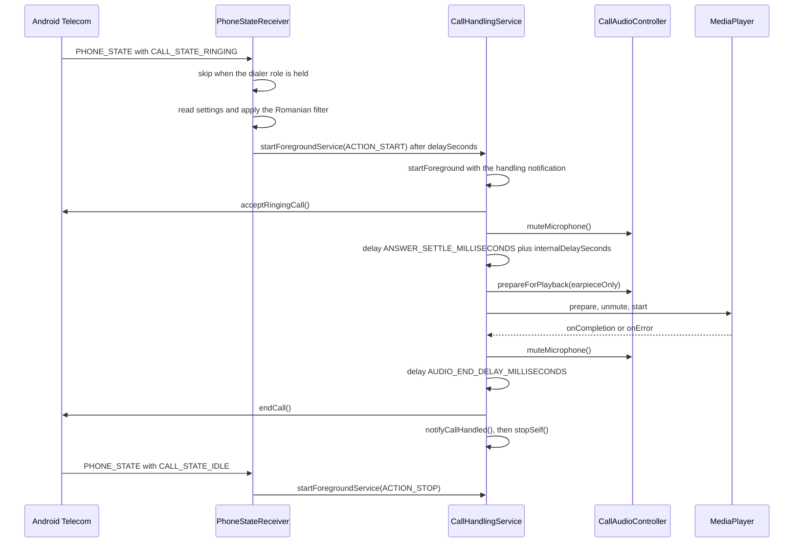
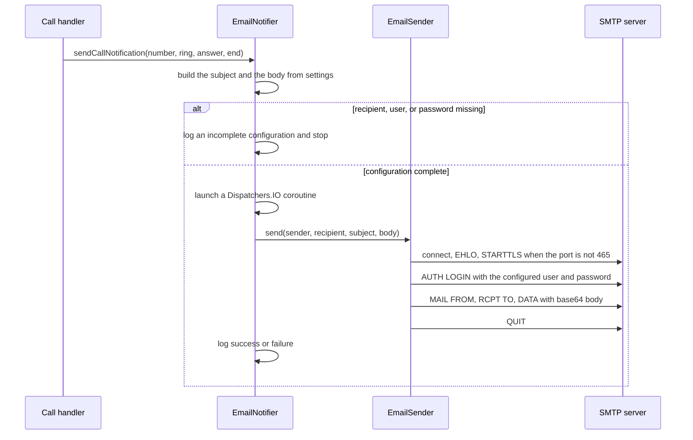
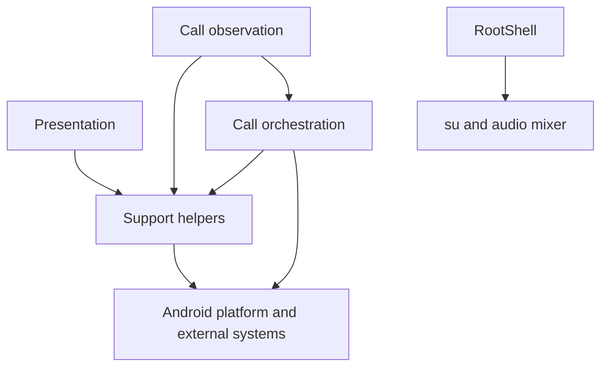

# Auto Call Responder Architecture

This document describes the current architecture of Auto Call Responder. Its scope is the single Android application module in this repository, the two call-observation paths that observe and answer incoming calls, the audio and microphone control applied during a handled call, the settings and audio-file storage, the e-mail notification pipeline, and the optional root-assisted audio routing. No target architecture is described: every statement reflects the implementation present in the repository.

## 📑 Table of Contents

- [Purpose](#-purpose)
- [System Context](#-system-context)
- [Architectural Style](#️-architectural-style)
- [Runtime Process](#-runtime-process)
- [Components](#-components)
- [Architectural Areas](#️-architectural-areas)
  - [Application and Presentation](#application-and-presentation)
  - [Call Observation](#call-observation)
  - [Call Handling](#call-handling)
  - [Platform and Data Access](#platform-and-data-access)
- [Data Architecture](#-data-architecture)
- [Interfaces and Integrations](#-interfaces-and-integrations)
- [Key Processes](#-key-processes)
  - [Answering a Call as the Default Dialer](#answering-a-call-as-the-default-dialer)
  - [Legacy Broadcast Call Handling](#legacy-broadcast-call-handling)
  - [Notification E-mail Delivery](#notification-e-mail-delivery)
- [Romanian Number Matching](#️-romanian-number-matching)
- [Root-Assisted Uplink Routing](#️-root-assisted-uplink-routing)
- [Cross-Cutting Concerns](#-cross-cutting-concerns)
  - [Security and Privacy](#security-and-privacy)
  - [Error Handling](#error-handling)
  - [Observability](#observability)
  - [Configuration](#configuration)
  - [Concurrency and Resource Use](#concurrency-and-resource-use)
- [Dependency Direction and Rules](#-dependency-direction-and-rules)
- [External Dependencies](#-external-dependencies)
- [Deployment and Operations](#-deployment-and-operations)
- [Compatibility Contracts](#-compatibility-contracts)
- [Testing and Verification](#-testing-and-verification)
- [Design Constraints](#️-design-constraints)
- [Architecture Decisions](#-architecture-decisions)
- [Source Map](#-source-map)
- [Related Documentation](#-related-documentation)

## 🎯 Purpose

Auto Call Responder answers selected incoming calls automatically after a configurable delay, plays a local audio file during the handled call, keeps the microphone muted outside that recording, ends the call after playback, and sends an e-mail describing the call once it has been disconnected.

The application owns the call-handling sequence, the settings and audio-file state on the device, and the notification composition. It does not own the Android call stack, the SMTP transport, the device audio hardware, or the root implementation that optionally exposes the audio mixer.

This document is intended for contributors who need to locate the component that owns a behaviour, understand why two call-observation paths exist, and identify the contracts that must remain stable when the answering sequence, the settings schema, or the audio controls change.

## 🌐 System Context

Auto Call Responder is a device-local application. Android Telecom initiates every meaningful interaction by binding the screening and in-call services and by broadcasting phone-state changes. All persistent state belongs to the application's private storage, and the only outbound network interaction is the notification e-mail sent to the configured SMTP server.



The principal external boundaries are:
- **Android Telecom framework:** Delivers screening and in-call callbacks, accepts `Call.answer`, `Call.disconnect`, and `TelecomManager` requests, and binds the services only while the application holds the dialer and call-screening roles.
- **Caller:** The remote party whose call is answered; it hears the device audio route rather than the imported recording, because public Android APIs cannot inject audio into the voice uplink.
- **Device user:** Grants runtime permissions, the dialer and call-screening roles, optional root access, and the battery-optimisation exemption, and edits the settings.
- **External SMTP server:** Accepts the notification message over STARTTLS, or over implicit TLS on port 465, using `AUTH LOGIN` authentication.
- **Operator mailbox:** Receives the notification e-mail addressed to the configured recipient.
- **Root shell and audio mixer:** Provide `su` and a mixer binary such as `tinymix` when the device is rooted; this is the only route that can attempt to place local playback into the voice uplink.
- **Private application storage:** Holds the settings JSON in shared preferences and the imported audio file in the application files directory.

## 🏗️ Architectural Style

The implemented style is a layered, event-driven Android application. Activities, services, and broadcast receivers form the outer trigger layer and translate Android callbacks into calls on a small set of helpers that own settings access, number matching, audio control, and notification delivery. `AutoCallResponderApplication` acts as the composition root by initialising `SettingsManager` for the process.

Two call-observation adapters coexist. The role-bound Telecom services, `CallScreeningService` and `AutoCallInCallService`, are authoritative while the application is the default dialer. The legacy `PHONE_STATE` broadcast path through `PhoneStateReceiver` covers Android 8 and 9, and any state in which the application does not hold the dialer role. Both adapters use the same helpers but implement the answering sequence separately, in `AutoCallInCallService` and `CallHandlingService`.

The principal consequences are that helper changes reach both call paths, while sequencing changes must be applied twice, and that only the dialer path can use the supported `InCallService` mute and route APIs. The legacy path depends on `TelecomManager` together with root or best-effort `AudioManager` fallbacks.

```mermaid
flowchart TB
    subgraph Presentation["Presentation"]
        MainActivity
        SettingsActivity
    end

    subgraph Observation["Call observation"]
        CallScreeningService
        AutoCallInCallService
        PhoneStateReceiver
        BootReceiver
    end

    subgraph Orchestration["Call orchestration"]
        CallHandlingService
        CallAudioController
        RomanianPhoneNumbers
    end

    subgraph Support["Platform and support"]
        SettingsManager
        AudioFilePicker
        EmailNotifier
        EmailSender
        RootShell
    end

    MainActivity -->|settings and audio selection| SettingsManager
    MainActivity -->|file import| AudioFilePicker
    SettingsActivity -->|settings and audio selection| SettingsManager
    SettingsActivity -->|file import| AudioFilePicker
    SettingsActivity -->|detect and request root| RootShell
    CallScreeningService -->|enabled flag and filter| SettingsManager
    CallScreeningService -->|number matching| RomanianPhoneNumbers
    AutoCallInCallService -->|settings| SettingsManager
    AutoCallInCallService -->|number matching| RomanianPhoneNumbers
    AutoCallInCallService -->|mute and route control| CallAudioController
    AutoCallInCallService -->|call notification| EmailNotifier
    PhoneStateReceiver -->|settings and filter| SettingsManager
    PhoneStateReceiver -->|number matching| RomanianPhoneNumbers
    PhoneStateReceiver -->|start and stop service| CallHandlingService
    CallHandlingService -->|settings| SettingsManager
    CallHandlingService -->|mute and route control| CallAudioController
    CallHandlingService -->|call notification| EmailNotifier
    CallAudioController -->|privileged commands| RootShell
    EmailNotifier -->|SMTP transaction| EmailSender
    EmailNotifier -->|settings| SettingsManager
    BootReceiver -->|settings and prerequisites| SettingsManager
    BootReceiver -->|root detection| RootShell
```



The principal architecture boundaries are:
- **Presentation:** The two activities and the audio-file picker; they own user interaction, permission and role requests, and settings editing.
- **Call observation:** The screening service, the in-call service, the phone-state receiver, and the boot receiver; they own the decision to handle a call and the translation of platform callbacks.
- **Call orchestration:** The foreground handling service, the audio controller, and the Romanian number matcher; they own the ordered answering, playback, mute, and disconnect sequence.
- **Platform and support:** The settings manager, the audio-file picker, the e-mail notifier and SMTP client, the root shell, and the application class; they own persistence, outbound network access, and privileged command execution.

## 🔄 Runtime Process

Application startup is limited to initialising the settings store and caching the application instance. The principal execution path is the dialer call sequence, which begins when Telecom reports a ringing call and ends when the notification has been dispatched.



The principal runtime sequence is:
1. `AutoCallResponderApplication.onCreate` caches the application instance and initialises `SettingsManager`; `BootReceiver` re-initialises the settings store after a reboot and reports missing roles or battery optimisation.
2. Telecom binds `CallScreeningService`, which allows every call to keep ringing and evaluates the enabled flag and the Romanian number filter without answering.
3. While the application is the default dialer, Telecom binds `AutoCallInCallService` and reports the ringing call; the service schedules the answer after the configured `delaySeconds`.
4. The service mutes the microphone, answers with `Call.answer(STATE_AUDIO_ONLY)`, and re-applies the mute when Telecom reports the call as active, because Telecom resets the mute flag during the transition.
5. After `ANSWER_SETTLE_MILLISECONDS` plus `internalDelaySeconds`, the service prepares the audio route, unmutes the microphone for the duration of the recording, and starts playback.
6. When playback completes or fails, the service mutes the microphone again, waits `AUDIO_END_DELAY_MILLISECONDS`, disconnects the call, and dispatches the notification e-mail exactly once.

## 🧩 Components

| Component | Responsibility | Principal Dependencies | Lifetime or Ownership |
|-----------|----------------|------------------------|-----------------------|
| `AutoCallResponderApplication` | Composition root; caches the application instance and initialises `SettingsManager` | `SettingsManager`, `ProcessLifecycleOwner` | One instance per application process |
| `MainActivity` | Launcher screen; toggles the responder, shows status, requests permissions and roles, sends a test e-mail, selects audio, opens the donation page | `SettingsManager`, `AudioFilePicker`, `EmailSender` | One instance while visible |
| `SettingsActivity` | Edits delays, e-mail and SMTP settings, filters, audio route, and the audio file; requests root access and the battery exemption | `SettingsManager`, `AudioFilePicker`, `RootShell` | One instance while visible |
| `AudioFilePicker` | Launches the first available document picker and copies the selected audio into application storage | `ContentResolver`, `FileProvider` | Stateless object |
| `SettingsManager` | Reads and writes the serialised `AppSettings` record and the imported audio URI | `SharedPreferences`, Gson | Process-wide object initialised once |
| `BootReceiver` | Restores readiness after a reboot, checks the dialer and screening roles and battery optimisation, and warms root detection | `RoleManager`, `PowerManager`, `SettingsManager`, `RootShell` | Invoked per qualifying broadcast |
| `CallScreeningService` | Observes incoming calls on Android 10 and later, always allows them, and decides whether the call is eligible for handling | `SettingsManager`, `RomanianPhoneNumbers` | Bound by Telecom for the duration of `onScreenCall` only |
| `AutoCallInCallService` | Authoritative handler while the application is the default dialer; owns the answer, mute, playback, disconnect, and notification sequence | `SettingsManager`, `RomanianPhoneNumbers`, `CallAudioController`, `EmailNotifier` | Bound by Telecom while the application holds the dialer role |
| `PhoneStateReceiver` | Legacy observation path for Android 8 and 9 or when the dialer role is absent; starts and stops `CallHandlingService` | `TelephonyManager`, `RoleManager`, `SettingsManager`, `RomanianPhoneNumbers` | Invoked per phone-state broadcast |
| `CallHandlingService` | Foreground service that performs the legacy answering, playback, disconnect, and notification sequence | `TelecomManager`, `SettingsManager`, `CallAudioController`, `EmailNotifier` | Started per legacy call and stopped when handling completes |
| `CallAudioController` | Owns microphone mute, call audio route selection, and root-assisted uplink routing for one call | `InCallService`, `AudioManager`, `RootShell` | Created per handled call and discarded when the call ends |
| `RomanianPhoneNumbers` | Normalises and validates Romanian fixed-line and mobile numbers | None | Stateless object |
| `RootShell` | Detects root and runs `su` commands with timeouts | `su` process execution | Process-wide cache of the detected root state |
| `EmailNotifier` | Composes the subject and body of the call notification and dispatches it asynchronously | `SettingsManager`, `EmailSender`, `Build` | Stateless object |
| `EmailSender` | Performs a single SMTP transaction using STARTTLS or implicit TLS and `AUTH LOGIN` | `java.net.Socket`, `javax.net.ssl` | One instance per message |

## 🗂️ Architectural Areas

### Application and Presentation

Paths:
- `app/src/main/java/ro/nucilandia/autocallresponder/MainActivity.kt`
- `app/src/main/java/ro/nucilandia/autocallresponder/SettingsActivity.kt`
- `app/src/main/java/ro/nucilandia/autocallresponder/AudioFilePicker.kt`
- `app/src/main/res/layout/activity_main.xml`
- `app/src/main/res/layout/activity_settings.xml`

Responsibilities:
- Render the responder status, the enable switch, the effective delays, the recipient address, and the audio selection.
- Request runtime permissions, the dialer role, the call-screening role, root access, and the battery-optimisation exemption.
- Import the selected audio document into application storage and expose it through the file provider.

Boundary rules:
- Presentation code reads and writes settings only through `SettingsManager`.
- Presentation code never answers or observes calls; it only requests the roles and permissions that allow the services to do so.
- Only `FileProvider` URIs leave the audio picker, so no raw external document URI is persisted.

### Call Observation

Paths:
- `app/src/main/AndroidManifest.xml`
- `app/src/main/java/ro/nucilandia/autocallresponder/CallScreeningService.kt`
- `app/src/main/java/ro/nucilandia/autocallresponder/AutoCallInCallService.kt`
- `app/src/main/java/ro/nucilandia/autocallresponder/PhoneStateReceiver.kt`
- `app/src/main/java/ro/nucilandia/autocallresponder/BootReceiver.kt`

Responsibilities:
- Observe incoming calls through the screening service, the in-call service, or the legacy phone-state broadcast.
- Decide eligibility from the enabled flag and the Romanian number filter.
- Suppress the legacy path while the application is the default dialer, so a call is never answered twice.

Boundary rules:
- `CallScreeningService` may only allow, reject, or silence a call; it must not answer or play audio.
- The legacy broadcast path must stay gated on `RoleManager.ROLE_DIALER`, because Telecom binds `AutoCallInCallService` whenever the role is held.
- `BootReceiver` must not start long-lived work; Telecom binds the services on its own when the roles survive the reboot.

### Call Handling

Paths:
- `app/src/main/java/ro/nucilandia/autocallresponder/CallHandlingService.kt`
- `app/src/main/java/ro/nucilandia/autocallresponder/CallAudioController.kt`
- `app/src/main/java/ro/nucilandia/autocallresponder/RomanianPhoneNumbers.kt`

Responsibilities:
- Drive the ordered answer, mute, playback, disconnect, and notification sequence for one call.
- Cancel every pending delay and stop playback as soon as the call ends, while still emitting the notification.
- Apply microphone mute and audio route changes through the strongest mechanism available on the current path.

Boundary rules:
- Every delay in the dialer path is scheduled through the session so that it can be cancelled when the call ends.
- The microphone is unmuted only for the duration of the recording.
- Root-specific audio routing lives only in `CallAudioController`; other components must not issue mixer commands.

### Platform and Data Access

Paths:
- `app/src/main/java/ro/nucilandia/autocallresponder/AutoCallResponderApplication.kt`
- `app/src/main/java/ro/nucilandia/autocallresponder/SettingsManager.kt`
- `app/src/main/java/ro/nucilandia/autocallresponder/EmailNotifier.kt`
- `app/src/main/java/ro/nucilandia/autocallresponder/EmailSender.kt`
- `app/src/main/java/ro/nucilandia/autocallresponder/RootShell.kt`
- `app/src/main/res/xml/file_paths.xml`

Responsibilities:
- Persist and expose the settings record and the imported audio URI.
- Compose the notification text and perform the SMTP transaction.
- Detect root asynchronously, cache the result, and execute privileged commands with timeouts.
- Declare the file-provider path that makes the imported audio readable by the media player.

Boundary rules:
- `SettingsManager` is the only component that touches shared preferences.
- `EmailSender` receives credentials as constructor arguments and never reads settings itself.
- `RootShell` never blocks the main thread during detection; callers use the cached availability or the asynchronous callback.

## 💾 Data Architecture

The application persists two artefacts: a JSON-serialised `AppSettings` record and the imported audio file. Call metadata lives only in memory for the duration of a handled call. No database, migration framework, or synchronisation protocol exists.



| Data or Store | Owner | Representation and Storage | Lifecycle or Consistency |
|---------------|-------|----------------------------|--------------------------|
| `AppSettings` | `SettingsManager` | A JSON string under key `settings` in the private shared preferences file `AutoCallResponderPrefs`, produced by Gson | Written on every settings save; read at each decision point; no schema version or migration |
| `Imported audio URI` | `SettingsManager` | A string under key `audio_file_uri` in the same shared preferences file | Written after a successful import; cleared by the clear-audio action; the preferred source is `AppSettings.audioFilePath` when present |
| `Imported audio file` | `AudioFilePicker` | `selected_call_audio.<extension>` inside `filesDir/call_audio`, exposed by authority `${applicationId}.fileprovider` | The directory is purged on each import, so exactly one file is retained |
| `Call session` | The active call handler | In-memory `CallSession` with the caller number, ring, answer, and end timestamps, and notification and cancellation flags | Lives for one call; discarded when the call ends; never persisted |
| `Root availability` | `RootShell` | A `@Volatile` nullable Boolean cached for the process | Cleared and re-detected on explicit request; never persisted |

## 🔌 Interfaces and Integrations

| Interface or Integration | Direction | Contract | Owner | Failure Semantics |
|--------------------------|-----------|----------|-------|-------------------|
| `android.telecom.CallScreeningService` | Inbound | Telecom binds the service; `onScreenCall` returns a `CallResponse` and the binding is released immediately afterwards | `CallScreeningService` | An exception or a non-allow response would affect the call, so the implementation always allows it and only logs the decision |
| `android.telecom.InCallService` | Inbound | Telecom binds the service while the application holds the dialer role; `onCallAdded`, `onCallRemoved`, and `Call.Callback` drive the sequence | `AutoCallInCallService` | Answer and disconnect failures are caught and logged; the session still finishes and still notifies |
| `TelecomManager.acceptRingingCall` and `endCall` | Outbound | Answering and ending through the telecom service, guarded by `ANSWER_PHONE_CALLS` and the API level | `CallHandlingService` | A missing permission or API level is logged and the step is skipped |
| `Call.answer` and `Call.disconnect` | Outbound | The supported per-call answer and disconnect operations on the dialer path | `AutoCallInCallService` | Failures are logged; the session is cleared without retrying |
| `PHONE_STATE` broadcast | Inbound | `TelephonyManager.ACTION_PHONE_STATE_CHANGED` with state and incoming number extras | `PhoneStateReceiver` | Duplicate states are ignored through a cached last-state value; the number may be absent on restricted devices |
| `BOOT_COMPLETED`, `QUICKBOOT_POWERON`, `MY_PACKAGE_REPLACED` broadcasts | Inbound | System broadcasts that restore readiness after a reboot or update | `BootReceiver` | Missing roles or battery exemption are logged only |
| SMTP | Outbound | Text e-mail over STARTTLS, or implicit TLS on port 465, authenticated with `AUTH LOGIN` and CRLF-terminated commands | `EmailSender` | Every non-expected status raises `IOException`; callers log and abandon the message without retry |
| `MediaPlayer` | Outbound | Plays the imported file with `USAGE_VOICE_COMMUNICATION` and `CONTENT_TYPE_SPEECH` | `CallHandlingService`, `AutoCallInCallService` | Completion and error both complete the wait, so the sequence always proceeds to disconnect |
| `FileProvider` | Internal | `${applicationId}.fileprovider` resolves `files-path` entries declared in `file_paths.xml` | `AudioFilePicker` | Import failures return `null` and show a toast |
| `su` and audio mixer | Outbound | `ProcessBuilder("su", "-c", command)` with a five-second limit, and mixer control pairs such as `tinymix` route names | `RootShell`, `CallAudioController` | Unavailable root or an unsupported mixer leaves local playback intact and is logged as expected degradation |

## 🔀 Key Processes

### Answering a Call as the Default Dialer



Session identity is the call handle together with its creation time, so a repeated `STATE_RINGING` cannot schedule a second answer. Scheduling is funneled through the session, and every scheduled action re-checks the ending flag, so `STATE_DISCONNECTED` cancels the remaining delay, stops playback, and still triggers the single notification. The mute is applied before `answer` because Telecom resets it when the call becomes active, and a follow-up task re-applies it as a safety net when the active callback is lost or reordered.

### Legacy Broadcast Call Handling



The receiver clears every pending delayed start as soon as the call becomes idle, and it forwards the caller number to `CallHandlingService` so a call that ended during the pre-answer delay still produces a notification. If the service was never started for handling, `ACTION_STOP` starts the foreground notification, reports the ended call, and stops itself. The service returns `START_NOT_STICKY`, so an interrupted handling run is not silently restarted without a call.

### Notification E-mail Delivery



The message is only dispatched after the call has been disconnected, so an SMTP transaction never delays the ending. The body is base64 encoded with a UTF-8 content type, and the subject is encoded as an RFC 2047 base64 header when it contains non-ASCII characters. Delivery is asynchronous and fire-and-forget: the handler does not observe the SMTP outcome, and a failure is only logged on the device.

## ⚙️ Romanian Number Matching

`RomanianPhoneNumbers.isRomanian` normalises the raw handle by removing a `tel:` prefix, stripping spaces, hyphens, dots, parentheses, and slashes, and trimming the result. It then converts `+40`, `0040`, and bare `40` prefixes to national form by prepending `0`, and accepts the number only when it matches `^0[237]\d{8}$`.

The matcher is used by both call paths and is consulted only when `filterRomanianNumbers` is enabled. It is a pure function with no Android dependency, which is what makes it the only behaviour covered by automated tests. Because an unreadable caller identifier yields an empty number, the filter excludes such calls when it is enabled; disabling the filter is the supported way to handle restricted identifiers.

## ⚙️ Root-Assisted Uplink Routing

`RootShell` detects root on a dedicated thread by running `su -c id` with a sixty-second limit, then caches the outcome and returns it to the main thread through a handler. Detection is never performed on the main thread, because the root manager presents a permission prompt. Commands run with `su -c` and a five-second default limit, and both the process and its combined output are discarded when the limit expires.

`CallAudioController` treats root as optional. When root is available, it looks for `tinymix`, `tiny-mix`, or `/vendor/bin/tinymix` and applies the first control pairs that succeed from a fixed catalogue of Qualcomm and MediaTek uplink loopback names. Failure is expected on devices whose kernel does not expose such a control, and the application deliberately keeps local playback intact rather than treating the absence of root as an error. The applied controls are restored, and the audio mode returns to `MODE_NORMAL`, when the call ends.

## 🧵 Cross-Cutting Concerns

### Security and Privacy

The trust boundary runs between the application and three privileged surfaces: the Telecom roles, which allow answering and disconnecting calls; the optional root shell, which allows arbitrary commands as root; and the SMTP credentials, which are sent to the configured server in clear text inside a TLS session.

There is no authentication of the device user. The dialer and call-screening roles are granted by the operating system, and root access is granted by the device root manager. The application never asks for credentials beyond the SMTP account, and it performs no certificate pinning, so it relies on the platform trust store for the SMTP TLS session.

Sensitive values are the SMTP password and the personal data in the notification body: caller number, timestamps, device manufacturer and model, and the effective settings. The SMTP password is stored in the private shared preferences file, which is not encrypted beyond the platform's own application sandbox, and the README discloses that limitation. Passwords are never written to the log. Caller numbers are written to logcat by the observation and handling components, which is relevant on devices where third-party tools can read logs.

### Error Handling

Platform failures are translated locally. Calls into `TelecomManager`, `Call.answer`, `Call.disconnect`, `AudioManager`, `MediaPlayer`, and the file provider are wrapped in `try` blocks; failures are logged and the sequence either degrades or skips that step. A playback failure still reaches the disconnect step and still produces the notification, because completion and error both release the wait.

Notification delivery is made idempotent by an `isNotified` flag on the dialer path and an `isHandled` flag on the legacy path, both checked under `@Synchronized`, so a call that ends through either the application or the caller produces exactly one e-mail.

The SMTP client throws `IOException` for a closed connection, an unexpected status line, or a rejected transaction. `EmailNotifier` catches every exception from the coroutine and logs it; no retry, queue, or durable outbox exists. Missing recipient or credential settings suppress the message with a warning.

### Observability

Observability is limited to logcat. Every component writes under a fixed tag (`CallHandlingService`, `AutoCallInCallService`, `CallScreeningService`, `PhoneStateReceiver`, `CallAudioController`, `RootShell`, `EmailNotifier`, `AudioFilePicker`, `MainActivity`, `SettingsActivity`, `BootReceiver`), and the call sequence is traceable through the answer, mute, playback, and disconnect messages.

The durable operator-visible signals are the foreground notification, which shows the caller being handled, and the notification e-mail, which reports the timings and the effective settings. There are no metrics, traces, health checks, or structured logs, and the SMTP outcome is visible only on the device.

### Configuration

| Configuration Area | Source | Responsibility | Supersede or Secret Policy |
|--------------------|--------|----------------|---------------------------|
| Responder behaviour | `AppSettings` JSON in `AutoCallResponderPrefs` | Enables handling, sets the answer delay and the internal delay, and toggles the Romanian filter and the earpiece route | Single source; no environment or command-line override exists |
| Audio selection | `AppSettings.audioFilePath` and the `audio_file_uri` preference | Selects the recording played during the call | The settings field wins when non-blank; the preference is the fallback |
| Notification destination and transport | `AppSettings` fields `emailAddress`, `smtpHost`, `smtpPort`, `smtpUser`, and `smtpPassword` | Configures the SMTP recipient and account | Defaults are `smtp.gmail.com` and port `587`; the password is a secret stored in private shared preferences |
| Roles and permissions | Android role and permission state | Allows screening, answering, disconnecting, recording audio, and posting the foreground notification | Granted by the operating system; the application can only request them |
| Root access | Device root manager | Enables `su` and the audio mixer controls | Granted outside the application and cached for the process |
| Battery optimisation | System power settings | Keeps background call handling from being deferred | Requested through a system intent; the application cannot grant it |

### Concurrency and Resource Use

The dialer path schedules every step on the main-looper `Handler` and cancels the whole set when the call ends. The legacy path runs its sequence in a `CoroutineScope(Dispatchers.IO)` and cancels the job on `ACTION_STOP` or destruction. `activeSession` is `@Volatile`, and the notification methods are `@Synchronized`, so the end-of-call path and the completion path cannot both emit a message.

Exactly one call is handled at a time: the dialer path retains a single `mediaPlayer` and `audioController` field, and the legacy path guards a single active session. Bounded operations are playback, capped by a 120-second safety timeout, SMTP, capped by 20-second connect and read timeouts, root commands, capped at five seconds, and root detection, capped at sixty seconds. No queue, worker pool, or backpressure mechanism exists, so a second simultaneous call is not modelled.

## 🧭 Dependency Direction and Rules

Dependencies point inward from Android components towards the helpers, and only the helpers cross into platform or network boundaries. Presentation depends on the settings store and the audio picker, both call paths depend on the same orchestration helpers, and no helper depends on an activity, a service, or a receiver.



The principal dependency rules are:
- Activities and receivers should invoke helpers and services rather than implementing settings, matching, or e-mail logic inline.
- `SettingsManager` remains the only component that reads or writes shared preferences.
- `RomanianPhoneNumbers` remains free of Android dependencies so it stays unit-testable.
- Root-specific audio manipulation stays in `CallAudioController`, which is the only component that calls `RootShell` for routing.
- `EmailSender` receives its credentials as constructor arguments and must not reach into settings, so the test-email path and the call-notification path share the same transport.
- Both call paths must keep the same eligibility decision: the enabled flag followed by the Romanian filter.

## 📦 External Dependencies

| Dependency | Responsibility | Integration Boundary | Architectural Consequence |
|------------|----------------|----------------------|---------------------------|
| Android Telecom APIs | Deliver screening and in-call callbacks, answer and disconnect calls, and expose the supported mute and route controls | `CallScreeningService`, `AutoCallInCallService`, `CallHandlingService` | The answering capability is inseparable from holding the dialer and call-screening roles |
| `androidx.core`, `androidx.appcompat`, `com.google.android.material` | Provide the activity base classes, permission helpers, notification compatibility, and the layouts | Presentation and the foreground notification | The UI follows the AppCompat and Material component model |
| `androidx.lifecycle` | Provide the process lifecycle owner, the lifecycle scope, and coroutine integration | `AutoCallResponderApplication`, `MainActivity` | Lifecycle-scoped coroutines cancel with the activity, which matters for the test e-mail |
| `androidx.preference` | Supplies preference-related utilities to the settings screen | `app/build.gradle.kts` dependency set | Declared dependency; the settings screen itself is implemented with plain views |
| Gson | Serialises and deserialises `AppSettings` | `SettingsManager` | The JSON field names are an implicit persistence contract with no schema version |
| `kotlinx-coroutines-android` | Provide the IO dispatcher and cancellation used by the call sequence and the e-mail dispatch | `CallHandlingService`, `EmailNotifier`, `MainActivity` | Sequencing is structured for cancellation rather than for retry |
| JDK sockets and `javax.net.ssl` | Carry the SMTP conversation over STARTTLS or implicit TLS | `EmailSender` | The SMTP client is hand-written and depends on the platform trust store |
| `MediaPlayer` | Decodes and plays the imported audio file | `CallHandlingService`, `AutoCallInCallService` | Playback depends on the codec support of the device |
| `su` and an audio mixer binary | Provide privileged microphone and uplink routing when the device is rooted | `RootShell`, `CallAudioController` | Optional, device-specific, and never required for local playback |

## 🚀 Deployment and Operations

The deployment unit is a single Android application package installed on a device that can receive calls. There is no server, scheduler, or remote control plane. Persistent state is confined to the application sandbox, and the only network traffic is the notification e-mail.

| Concern | Current Design | Architectural Consequence |
|---------|----------------|---------------------------|
| Process topology | One application process hosting the activities, the bound Telecom services, the legacy foreground service, and the receivers | All call handling happens in-process; there is no separate background worker |
| Packaging | One Gradle module, `:app`, with `minSdk` 26 and `targetSdk` 36 | A single artefact must serve both the legacy broadcast path and the role-bound Telecom path |
| Release artefact | `assembleRelease` produces an unsigned APK with minification disabled | Signing is an operator step, and unobfuscated symbols make field diagnostics easier |
| Foreground work | `CallHandlingService` runs with `foregroundServiceType="phoneCall"` and posts a low-importance notification on `CallHandlingChannel` | The notification permission matters on Android 13 and later, and the service is short-lived per call |
| Persistent state | Shared preferences plus one imported audio file in internal storage | Uninstalling the application removes all state; there is no backup or export path |
| Availability and recovery | The service returns `START_NOT_STICKY`; the boot receiver only verifies prerequisites | An interrupted handling run is not restarted, while the roles keep the Telecom services available after a reboot |
| External prerequisites | Telephony hardware, a SIM card, the dialer and call-screening roles, and network access for SMTP | The application is non-functional for its primary purpose without the roles, and the e-mail feature is optional |
| Operator outputs | A foreground notification during handling and a notification e-mail after the call | There is no dashboard, metric, or remote audit trail |

## 🛡️ Compatibility Contracts

| Contract | Owner | Invariant | Verification | Change Policy |
|----------|-------|-----------|--------------|---------------|
| `settings` preference schema | `SettingsManager` | The shared preferences file `AutoCallResponderPrefs`, the keys `settings` and `audio_file_uri`, and the Gson field names of `AppSettings` must remain readable across upgrades | Manual upgrade testing across an installed build; Gson parsing at runtime | Add fields with defaults; renaming or removing a field requires an explicit migration |
| File provider authority | `AudioFilePicker` and `file_paths.xml` | The authority stays `${applicationId}.fileprovider` and the path mapping stays `files-path` for `call_audio/` | Manual audio selection and playback on a device | Must change together with the authority string and the manifest provider declaration |
| Telecom component declarations | `AndroidManifest.xml` | The screening service keeps `BIND_SCREENING_SERVICE` and the `CallScreeningService` intent action; the in-call service keeps `BIND_INCALL_SERVICE`, the `InCallService` action, and the `IN_CALL_SERVICE_UI` metadata | Manifest inspection and a device check of the dialer and screening roles | Removing or renaming these declarations disables the dialer path entirely |
| Romanian number grammar | `RomanianPhoneNumbers` | National, `+40`, `0040`, and bare `40` forms are accepted; membership in `0[237]` plus eight digits is required | `RomanianPhoneNumbersTests` | Extend the matcher with new tests; do not weaken existing assertions |
| Notification timing | Call handlers | The notification is dispatched only after the call is disconnected, and exactly once per call | Source review and manual call testing | Preserve the post-disconnect dispatch so SMTP never delays the ending |
| SMTP conversation | `EmailSender` | `AUTH LOGIN` is used, port 465 selects implicit TLS, other ports use STARTTLS, and commands end with CRLF | The test-email action in `MainActivity` against a real server | A protocol change requires an updated client and manual verification against each supported transport |
| Role prerequisites | `CallScreeningService`, `AutoCallInCallService`, `PhoneStateReceiver` | Screening requires the call-screening role, and the dialer path requires the dialer role, from Android 10 | Manual verification of role state in `BootReceiver` logs and on the main screen | Keep the legacy path gated on the dialer role whenever the Telecom path is bound |

## ✅ Testing and Verification

The repository has one automated test class, `RomanianPhoneNumbersTests`, which exercises the number matcher through national, international, formatted, foreign, and incomplete inputs. It is a JUnit 4 test in the `:app` module's `test` source set and runs on the host without an Android device.

No automated coverage exists for the answering sequence, the mute and route control, the settings persistence, the SMTP client, the file provider, or the boot receiver. Those behaviours require manual verification on a device with a SIM card and, for the dialer path, with the dialer and call-screening roles granted.

Execute the principal automated verification with:

```bash
./gradlew test
```

The lint task and the debug build are the other repository-supported checks:

```bash
./gradlew lint
./gradlew assembleDebug
```

Manual verification remains material for answering delay accuracy, microphone mute during and after playback, audio route selection, the notification e-mail contents, cancellation when the call ends early, and the optional root uplink routing.

## ⚠️ Design Constraints

- **No audio injection through public APIs:** The voice uplink is a hardware capture path, so the other party hears only the device route; uplink routing requires root and a mixer control that the kernel must expose.
- **Role dependency:** On Android 10 and later, screening requires the call-screening role and the authoritative handling path requires the dialer role, which the user must grant in the system UI.
- **Screening service lifetime:** Telecom unbinds `CallScreeningService` as soon as `onScreenCall` returns, so the service can only classify a call and never drive it.
- **Two implementations of one sequence:** `AutoCallInCallService` and `CallHandlingService` duplicate the ordering, mute, playback, and disconnect logic with different platform primitives.
- **Telecom resets the mute flag:** Muting before answering is undone when the call becomes active, so the mute is re-applied on `STATE_ACTIVE` and again through a scheduled safety task.
- **Unencrypted credential storage:** The SMTP password is stored in private shared preferences without additional encryption.
- **Fire-and-forget notifications:** SMTP delivery is asynchronous, has no retry or durable outbox, and its failure is observable only in logcat.
- **Caller identifier availability:** Devices that restrict caller identification produce empty numbers, which the Romanian filter then rejects while it is enabled.
- **Single-call model:** The dialer path keeps one player and one audio controller, and the legacy path keeps one active session, so concurrent calls are not modelled.
- **Foreground-service and notification permission:** Handling depends on `FOREGROUND_SERVICE_PHONE_CALL`, and visibility of the notification depends on `POST_NOTIFICATIONS` on Android 13 and later.
- **Battery optimisation:** Aggressive optimisation can delay the scheduled answer; the application can only request an exemption.
- **Caller numbers in logs:** Observation and handling components write the caller number to logcat, which is a deliberate diagnostic trade-off.

## 📝 Architecture Decisions

| Decision | Rationale | Consequence | Record |
|----------|-----------|-------------|--------|
| Handle calls through `InCallService` whenever the dialer role is held | `InCallService` is the only supported way to set the microphone mute and the call audio route; the `AudioManager` equivalents require a signature permission and silently do nothing for a normal application | The dialer path is authoritative and the legacy broadcast path is suppressed while the role is held | Documented here |
| Keep the screening service as a classifier only | Telecom unbinds the service when `onScreenCall` returns, and a screening service may only allow, reject, or silence a call | `CallScreeningService` always allows the call and defers answering to the in-call service | Documented here |
| Answer, then mute, then re-apply the mute on `STATE_ACTIVE` | Telecom clears the mute flag during the transition to active | The caller never hears the room, at the cost of a second mute call and a scheduled safety task | Documented here |
| Unmute only for the duration of the recording | Ambient sound must never reach the caller outside the intended playback | Playback is bracketed by explicit mute calls on both paths | Documented here |
| Send the notification only after the call is disconnected | SMTP latency must not delay the end of the call, and the body requires the end timestamp | Delivery is asynchronous and its outcome is not observed by the handler | Documented here |
| Persist one imported audio file instead of holding a document URI | External document grants are transient, whereas a local copy survives reloads and provider revocation | Storage is bounded by purging the directory on each import, and a file provider exposes the copy to the media player | Documented here |
| Treat root as optional and device-specific | Public APIs cannot route playback into the voice uplink, but most devices expose no loopback control even when rooted | Uplink routing is attempted opportunistically and degrades to local playback | Documented here |

## 🗺️ Source Map

| Area | Path |
|------|------|
| Application module build | `app/build.gradle.kts` |
| Application manifest and component declarations | `app/src/main/AndroidManifest.xml` |
| Application source | `app/src/main/java/ro/nucilandia/autocallresponder` |
| Layouts and resources | `app/src/main/res` |
| File provider paths | `app/src/main/res/xml/file_paths.xml` |
| Unit tests | `app/src/test/java/ro/nucilandia/autocallresponder` |
| Build and test workflow | `.github/workflows/android.yml` |
| Release workflow | `.github/workflows/github-release.yml` |

## 📚 Related Documentation

- [README.md](README.md) describes installation, settings, supported Android versions, permissions, privacy handling, and troubleshooting.
- [LICENSE](LICENSE) contains the GNU General Public License v3.0 or later under which the project is distributed.