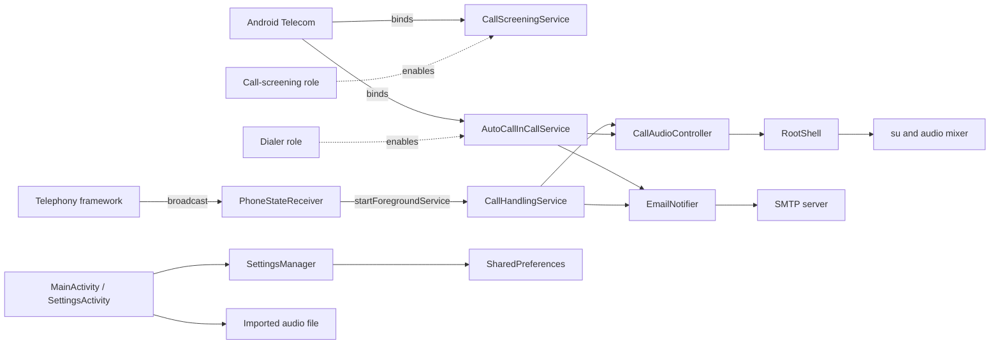

# Architecture

This document complements the repository root [ARCHITECTURE.md](../ARCHITECTURE.md). It does not reproduce that document; it adds the deployment topology, boundary ownership, and invariants that are convenient to hold in one place while navigating the source. When the two differ, the root document is authoritative for component responsibilities and runtime sequences, and this document is authoritative for the operational map.

## Deployment topology

The entire system runs in one Android application process on one device.

There is no server, worker pool, database, external queue, or remote API. The only outbound network traffic is the SMTP transaction.

## Ownership boundaries

| Boundary | Owner | Rule |
|----------|-------|------|
| Eligible-call decision | Observation layer | The enabled flag is checked before the Romanian filter, and the filter only applies when enabled. |
| Answer-and-playback sequence | `AutoCallInCallService` (dialer path) and `CallHandlingService` (legacy path) | Both must implement the same ordering: answer, mute, delay, route, play, mute, delay, disconnect, notify. |
| Microphone and route control | `CallAudioController` | No other component calls `InCallService.setMuted`, `InCallService.setAudioRoute`, or root mixer commands. |
| Settings persistence | `SettingsManager` | No other component touches shared preferences. |
| Root execution | `RootShell` | Only `CallAudioController` issues mixer commands; settings and boot only call detection. |
| SMTP transport | `EmailSender` | Credentials arrive as constructor arguments; the transport never reads settings. |
| Notification policy | `EmailNotifier` | Composes the message and suppresses it when recipient or credentials are incomplete. |

## Two-adapter model

The same capability is implemented twice because the supported platform APIs differ by role and API level.

| Aspect | Dialer path | Legacy path |
|--------|-------------|-------------|
| Observation | `CallScreeningService` + `AutoCallInCallService` | `PhoneStateReceiver` |
| Answer primitive | `Call.answer(VideoProfile.STATE_AUDIO_ONLY)` | `TelecomManager.acceptRingingCall()` |
| Disconnect primitive | `Call.disconnect()` | `TelecomManager.endCall()` |
| Mute primitive | `InCallService.setMuted`, root, then `AudioManager` | Root, then `AudioManager` |
| Route primitive | `InCallService.setAudioRoute` | `AudioManager.isSpeakerphoneOn` |
| Scheduling | Main-looper `Handler` with per-session cancellation | `CoroutineScope(Dispatchers.IO)` with job cancellation |
| Gate | Holds `ROLE_DIALER` | Only runs while `ROLE_DIALER` is **not** held |

The legacy path is suppressed while the dialer role is held, because Telecom binds `AutoCallInCallService` and both paths would otherwise answer the call and start two players.

## Failure domains

| Domain | Failure | Effect |
|--------|---------|--------|
| Roles | Dialer or screening role missing | Calls are not answered or not observed; only logging indicates it. |
| Permissions | `ANSWER_PHONE_CALLS` missing | Answer or disconnect is skipped and logged. |
| Audio | Unreadable audio file | Playback fails, the call is still disconnected, and the notification is still sent. |
| Root | Root unavailable or no mixer control | Playback stays local to the device; the caller hears nothing. |
| SMTP | Incomplete settings or server rejection | The notification is suppressed or abandoned with a log entry; no retry exists. |
| Process | Process killed mid-call | The session is lost; `START_NOT_STICKY` prevents an orphan restart. |

## Related documents

- Root [ARCHITECTURE.md](../ARCHITECTURE.md)
- [Design decisions](./design-decisions.md)
- [Invariants](./invariants.md)
- [Concurrency and scheduling](./concurrency-and-scheduling.md)
- [Components](./components/presentation.md)