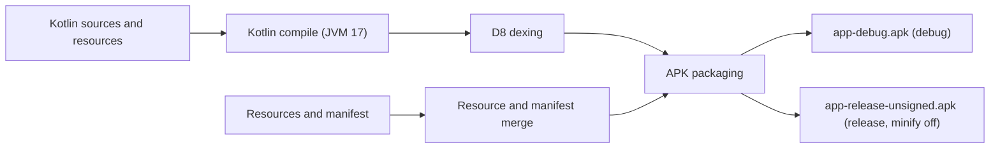

# Build and deployment

## Build pipeline

## Configuration

| Aspect | Value | Source |
|--------|-------|--------|
| Namespace / applicationId | `ro.nucilandia.autocallresponder` | `app/build.gradle.kts` |
| versionCode / versionName | `1` / `1.0.0` | `app/build.gradle.kts` |
| minSdk / targetSdk / compileSdk | 26 / 36 / 36 | `app/build.gradle.kts` |
| Java / Kotlin target | 17 | `app/build.gradle.kts` |
| Release minification | Disabled | `app/build.gradle.kts` (`isMinifyEnabled = false`) |
| Root project name | `AutoCallResponder` | `settings.gradle.kts` |

## Commands

| Task | Command | Output |
|------|---------|--------|
| Debug build | `./gradlew assembleDebug` | `app/build/outputs/apk/debug/app-debug.apk` |
| Release build | `./gradlew clean assembleRelease` | `app/build/outputs/apk/release/app-release-unsigned.apk` |
| Unit tests | `./gradlew test` | Test reports under `app/build/test-results` |
| Lint | `./gradlew lint` | Lint report under `app/build/reports` |
| Install on a device | `adb install app/build/outputs/apk/debug/app-debug.apk` | Installs the debug APK |

## Prerequisites

- JDK 17.
- Android SDK with the API 36 platform and build tools.
- `local.properties` with `sdk.dir`.

## Continuous integration

`.github/workflows/android.yml` runs on pushes and pull requests targeting `master`.

| Step | Action |
|------|--------|
| Checkout | `actions/checkout@v7` |
| JDK | `actions/setup-java@v6`, distribution `temurin`, version `17` |
| Gradle | `gradle/actions/setup-gradle@v6` |
| Build | `./gradlew assembleDebug --no-daemon` |
| Test | `./gradlew test --no-daemon` |

Lint is not part of the workflow. Reproduce the workflow locally with `./gradlew assembleDebug test`.

## Release

`.github/workflows/github-release.yml` runs when a GitHub release is published.

| Step | Action |
|------|--------|
| Checkout | `actions/checkout@v7` |
| JDK | `actions/setup-java@v6`, distribution `temurin`, version `17` |
| Gradle | `gradle/actions/setup-gradle@v6` |
| Version | Extracted from the release tag, with a leading `v` stripped |
| Build | `./gradlew clean assembleRelease --no-daemon` |
| Rename | `app/build/outputs/apk/release/app-release-unsigned.apk` becomes `AutoCallResponder_v<version>_unsigned.apk` |
| Publish | Attached to the GitHub release with `softprops/action-gh-release@v2` |

The published APK is unsigned and must be signed before installation or distribution.

## Deployment

The deployment unit is a single APK installed on a device that can receive calls. There is no server, container, or store pipeline in the repository.

| Concern | Design |
|---------|--------|
| Distribution | Debug and unsigned release APKs; signing is an operator step. |
| State | Private shared preferences plus one imported audio file; uninstalling removes all state. |
| Recovery | The foreground service returns `START_NOT_STICKY`; the boot receiver only verifies prerequisites. |
| External prerequisites | Telephony hardware, a SIM card, the dialer and call-screening roles, and network access for SMTP. |
| Operator outputs | A foreground notification during handling and a notification e-mail after the call. |

## Related documents

- [Dependencies](./dependencies.md)
- [Testing](./testing.md)
- [Quick start](./quick-start.md)