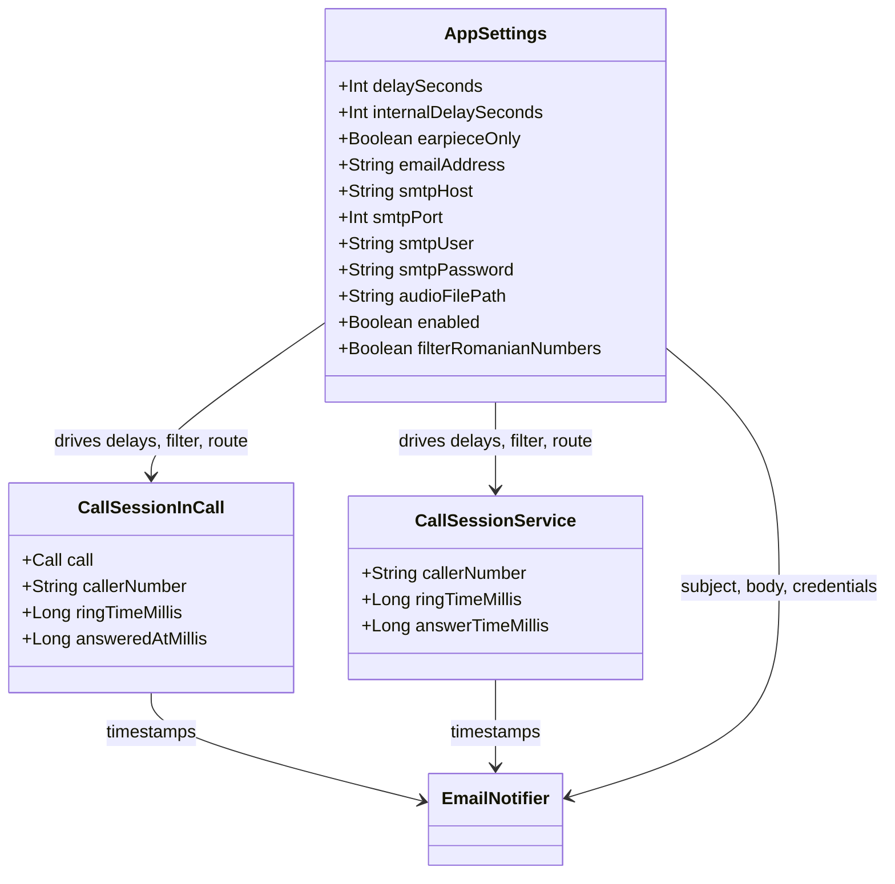

# Data model

## Persistent objects

### `AppSettings`

A Kotlin `data class` declared in `SettingsManager.kt`. It is the complete configuration record and is serialised to JSON by Gson with its property names as keys.

```kotlin
data class AppSettings(
    var delaySeconds: Int = 3,
    var internalDelaySeconds: Int = 2,
    var earpieceOnly: Boolean = true,
    var emailAddress: String = "",
    var smtpHost: String = "smtp.gmail.com",
    var smtpPort: Int = 587,
    var smtpUser: String = "",
    var smtpPassword: String = "",
    var audioFilePath: String = "",
    var enabled: Boolean = true,
    var filterRomanianNumbers: Boolean = true
)
```

| Property | Type | Default | Semantics |
|----------|------|---------|-----------|
| `delaySeconds` | `Int` | `3` | Ringing delay before answering. |
| `internalDelaySeconds` | `Int` | `2` | Delay after answering before playback. |
| `earpieceOnly` | `Boolean` | `true` | Route selection when playback starts. |
| `emailAddress` | `String` | `""` | Notification recipient. |
| `smtpHost` | `String` | `smtp.gmail.com` | SMTP server host. |
| `smtpPort` | `Int` | `587` | SMTP port; 465 selects implicit TLS. |
| `smtpUser` | `String` | `""` | SMTP user and sender address. |
| `smtpPassword` | `String` | `""` | SMTP password (secret). |
| `audioFilePath` | `String` | `""` | File-provider URI of the imported audio. |
| `enabled` | `Boolean` | `true` | Master switch. |
| `filterRomanianNumbers` | `Boolean` | `true` | Romanian-number eligibility filter. |

There is no schema version field. Adding a property with a default is backward compatible because Gson leaves absent fields at their Kotlin default only when the object is created by Gson with a no-argument constructor; because `AppSettings` has default values for every property, Kotlin generates a synthetic no-argument constructor that Gson can use.

### Imported audio file

A single file named `selected_call_audio.<extension>` inside `filesDir/call_audio`, where the extension is derived from the content resolver MIME subtype (defaulting to `mp3`). Its URI is stored in `AppSettings.audioFilePath` and in the `audio_file_uri` preference.

## In-memory objects

### `AutoCallInCallService.CallSession`

| Field | Type | Purpose |
|-------|------|---------|
| `call` | `Call` | The Telecom call being handled. |
| `callerNumber` | `String` | Normalised caller handle, spaces removed. |
| `identifier` | `String` | `"${handle}:${creationTimeMillis}"`; the session map key. |
| `ringTimeMillis` | `Long` | Creation time; used as the first-ring timestamp. |
| `answeredAtMillis` | `Long` | Set after a successful `call.answer`; `0` when not answered. |
| `isEnding` | `Boolean` | Set when the call ends; blocks further scheduling. |
| `isFinished` | `Boolean` | Guards against a double `finishSession`. |
| `isHandled` | `Boolean` | Guards the single notification. |
| `scheduledTasks` | `MutableList<Runnable>` | Cancellation set for every pending delay. |

### `CallHandlingService.CallSession`

| Field | Type | Purpose |
|-------|------|---------|
| `callerNumber` | `String` | Caller handle forwarded by the receiver. |
| `ringTimeMillis` | `Long` | Creation time (legacy path creates the session when handling starts). |
| `answerTimeMillis` | `Long` | Set after `acceptRingingCall`; `0` when not answered. |
| `isNotified` | `Boolean` | Guards the single notification. |

### `CallAudioController` state

| Field | Type | Purpose |
|-------|------|---------|
| `isMicrophoneMuted` | `Boolean` | Last mute state applied by this instance. |
| `isUplinkRoutingActive` | `Boolean` | Whether root uplink routes were applied. |
| `isRootAvailable` | `Boolean` | Whether root was detected during this call. |

## Notification payload

The notification is not a persisted object; it is a formatted string built by `EmailNotifier.buildBody` from:

- the caller number (or `Unknown / private number`);
- `ringTimeMillis`, `answerTimeMillis`, `endTimeMillis` and their formatted timestamps;
- derived durations: answer delay, call duration after answer, total time;
- the effective settings at the time of the call;
- `Build.MANUFACTURER`, `Build.MODEL`, `Build.VERSION.RELEASE`, `Build.VERSION.SDK_INT`.

## Relationships



## Related documents

- [State and persistence](./state-and-persistence.md)
- [Configuration](./configuration.md)
- [Flow: dialer call handling](./flows/dialer-call-handling.md)