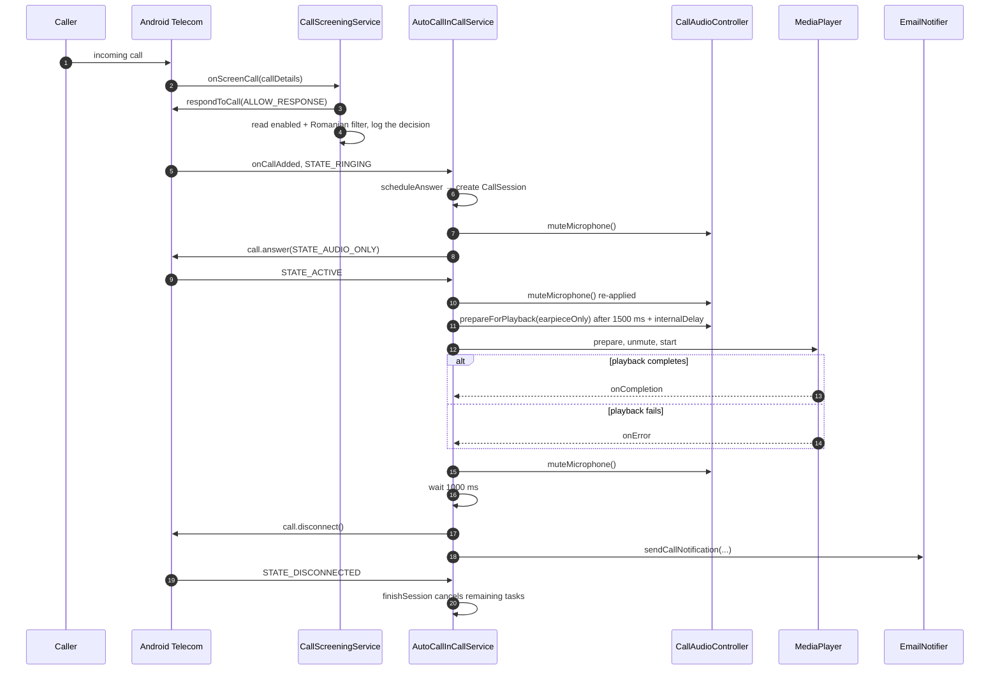

# Flow: dialer call handling

The authoritative path. It runs while the application holds the dialer role, which is what makes Telecom bind `AutoCallInCallService`.

## End-to-end sequence

## Step detail

| # | Trigger | Location | Effect |
|---|---------|----------|--------|
| 1 | `onScreenCall` | `CallScreeningService` | Always allow; log whether the call will be handled. |
| 2 | `onCallAdded` / `STATE_RINGING` | `AutoCallInCallService.scheduleAnswer` | Disabled? stop. Filtered? stop. Existing session? stop. Otherwise create the session and schedule `answer` after `delaySeconds`. |
| 3 | Scheduled | `answer` | Create the controller, mute, `call.answer(STATE_AUDIO_ONLY)`, record the answered time, schedule a 600 ms mute re-apply and the playback step at 1500 ms + `internalDelaySeconds`. |
| 4 | `STATE_ACTIVE` | Callback | Re-apply the mute, because Telecom resets it during the transition. |
| 5 | Scheduled | `playAudio` | Resolve the audio URI; if absent, end the call. Otherwise prepare the player, unmute, start. |
| 6 | Completion or error | Listener | Mute and schedule `endCall` after 1000 ms. |
| 7 | Scheduled | `endCall` | Mute, stop audio, disconnect, notify. |
| 8 | `STATE_DISCONNECTED` / `onCallRemoved` | `finishSession` | Mark finished and ending, cancel tasks, stop audio, remove the session, notify once. |

## Cancellation when the call ends early

`finishSession` sets `isEnding`, which causes:

- `CallSession.schedule` to refuse new tasks;
- already-posted runnables to return immediately when they run;
- `cancelScheduledTasks` to remove them from the handler.

The notification is still emitted during `finishSession`, with `answerTimeMillis = 0` when the call ended before the answer. The body then reports "not answered automatically" and omits the answer delay and talk duration.

## Failure branches

| Failure | Behaviour |
|---------|-----------|
| `call.answer` throws | The controller is unmuted, the controller reference is cleared, and the sequence stops. The session remains until the call disconnects, at which point `finishSession` notifies. |
| No audio configured | `endCall` runs directly. |
| Player prepare or start throws | The microphone is muted and `endCall` runs directly. |
| Playback error callback | Treated like completion: mute, delay, end. |
| `call.disconnect` throws | Logged; the notification is still sent. |

## Idempotency

- `sessions.containsKey(identifier)` prevents a second answer for the same call.
- `isFinished` prevents a second `finishSession`.
- `isHandled` prevents a second notification.

## Related documents

- [Flow: legacy call handling](./legacy-call-handling.md)
- [Call orchestration component](../components/call-orchestration.md)
- [Invariants](../invariants.md)