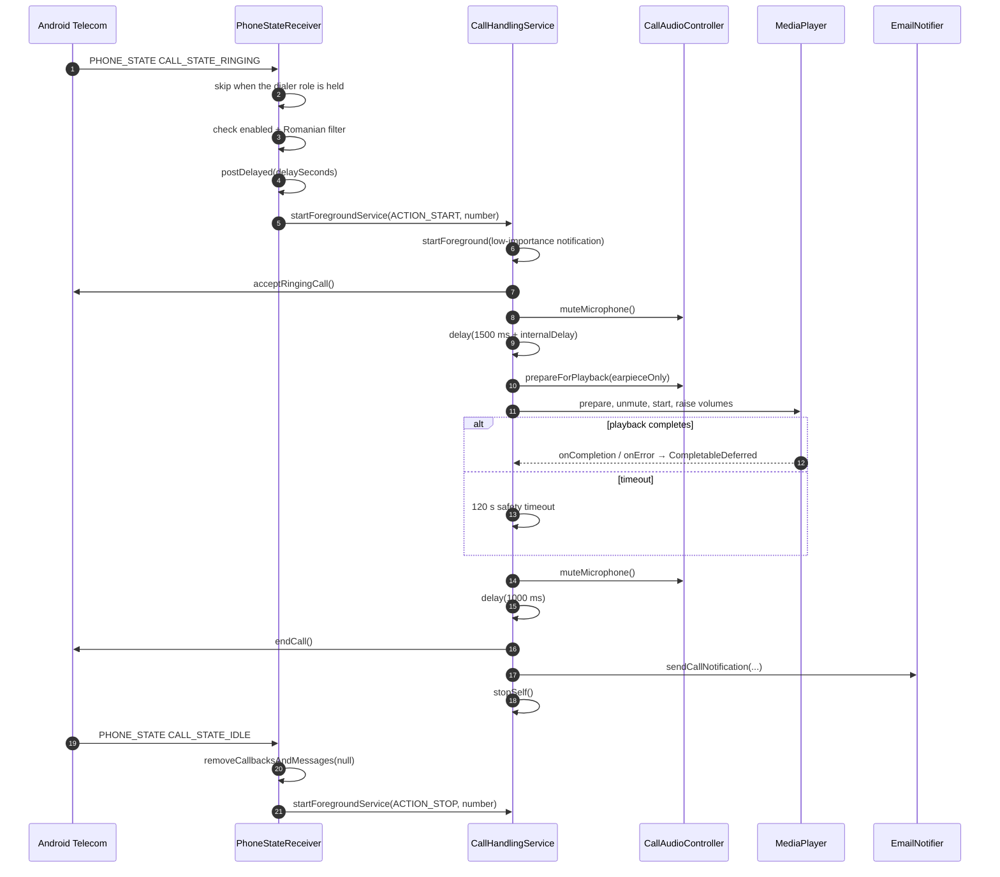

# Flow: legacy call handling

The broadcast path. It runs on Android 8 and 9 and in any state where the application does **not** hold the dialer role. It is guarded so it never runs while the dialer path is active.

## End-to-end sequence

## Step detail

| # | Trigger | Location | Effect |
|---|---------|----------|--------|
| 1 | `RINGING` | `PhoneStateReceiver.onReceive` | Ignore when the dialer role is held; otherwise normalise the number and check eligibility. |
| 2 | Eligible and delayed | `startCallHandling` | `startForegroundService` with `ACTION_START` and the caller number. |
| 3 | `ACTION_START` | `CallHandlingService.onStartCommand` | Show the foreground notification and call `handleCall`. |
| 4 | In the coroutine | `answerCall` | `TelecomManager.acceptRingingCall` when `ANSWER_PHONE_CALLS` is granted. |
| 5 | After the answer | `handleCall` | Mute, then `delay(1500 + internalDelay * 1000)`. |
| 6 | Playback | `playAudioFileAndAwait` | Prepare the route, create the player, unmute, start, raise `STREAM_VOICE_CALL` and `STREAM_MUSIC` to maximum, await with a 120 s timeout. |
| 7 | After playback | `handleCall` | Mute, `delay(1000)`, `endCall` through `TelecomManager.endCall`. |
| 8 | `finally` | `handleCall` | `restoreAfterPlayback`, `notifyCallHandled`, `stopSelf`. |
| 9 | `IDLE` | `PhoneStateReceiver` | Cancel the pending start and send `ACTION_STOP` with the number. |

## `ACTION_STOP` handling

`endSession` has two branches:

- **A session is active:** cancel the job, stop audio, clear the session, notify once, stop the service.
- **No session is active:** the call ended during the pre-answer delay, so the service shows the foreground notification, reports the ended call (creating a session whose ring time is the report time), and stops.

## Interaction with the dialer path

- The receiver skips `RINGING` when `ROLE_DIALER` is held.
- `stopCallHandling` also returns early when the dialer role is held, so on the dialer path no service is ever started or stopped.

## Failure branches

| Failure | Behaviour |
|---------|-----------|
| `ANSWER_PHONE_CALLS` missing | `acceptRingingCall` is skipped and logged; the sequence continues and still ends, notifies, and stops. |
| API below 28 | `endCall` is skipped and logged. |
| No audio configured | `playAudioFileAndAwait` returns without playing; the sequence continues to end the call. |
| Playback error | The `CompletableDeferred` completes; the sequence continues. |
| Playback exceeds 120 s | `withTimeoutOrNull` returns `null`, the timeout is logged, and the sequence continues. |
| `startForegroundService` for `ACTION_STOP` throws | Logged as a warning. |

## Idempotency

- `isNotified` guards the single notification.
- `stopAudio` and `notifyCallHandled` are `@Synchronized`.
- `START_NOT_STICKY` prevents an orphan restart after an interruption.

## Related documents

- [Flow: dialer call handling](./dialer-call-handling.md)
- [Call orchestration component](../components/call-orchestration.md)
- [Ambiguities and open questions](../ambiguities-and-open-questions.md)