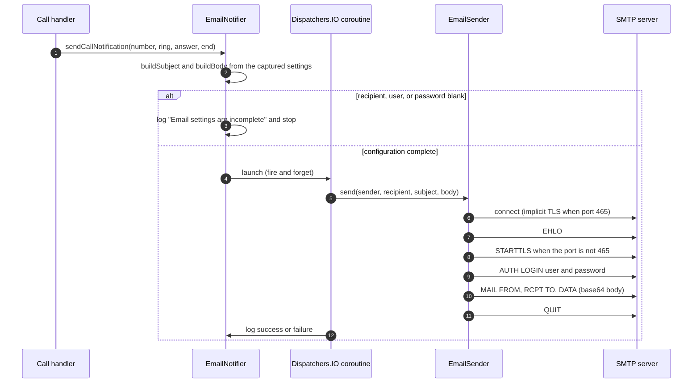

# Flow: notification delivery

Both call paths converge on `EmailNotifier.sendCallNotification` after the call has been disconnected.

## Sequence

## Timing guarantee

`notifyCallHandled` is invoked after the disconnect attempt on both paths, so the end timestamp is accurate and the SMTP transaction never delays the end of the call. Delivery is asynchronous and its outcome is never observed by the call handler.

## Message content

| Part | Source |
|------|--------|
| Subject | "Handled a call from `<number>`" or "Handled an unknown call". |
| Body | Call summary, playback description, effective settings, device information, and a footer. |
| Timestamps | Formatted `yyyy-MM-dd HH:mm:ss` in the default locale. |
| Durations | Answer delay, talk time, and total time computed from the three timestamps. |

See [Notification component](../components/notifications.md#emailnotifier) for the section-by-section body layout.

## SMTP transport selection

| Port | Transport |
|------|-----------|
| `465` | Implicit TLS (`SSLSocketFactory.createSocket(plainSocket, host, port, true)` then `startHandshake`). |
| Any other | Plain connection followed by `STARTTLS`, then TLS. |

Authentication is attempted only when the user name is non-blank. The sender address equals the configured user name.

## Error handling

| Condition | Result |
|-----------|--------|
| Recipient, user, or password blank | No message; a warning is logged. |
| Connect or read timeout (20 s) | `IOException`; logged by the notifier. |
| Unexpected status line | `IOException("SMTP server rejected the request: <line>")`; logged. |
| Server closes the connection | `IOException("The SMTP server closed the connection")`; logged. |
| Test e-mail path | The failure is surfaced in a toast by `MainActivity`. |

No retry, queue, or durable outbox exists, so a failed notification is lost.

## Related documents

- [Behaviour: call notification e-mails](../behaviour/call-notification-emails.md)
- [Notifications component](../components/notifications.md)
- [Integrations](../integrations.md)