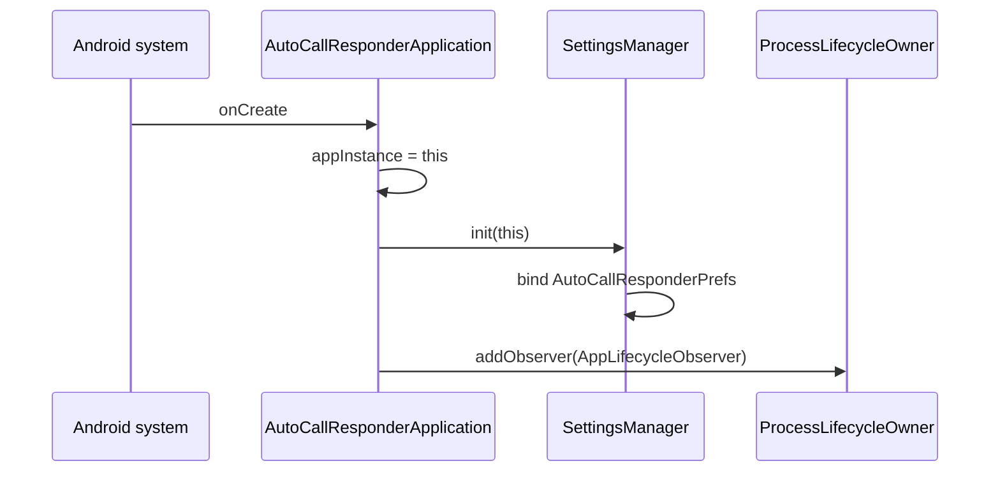
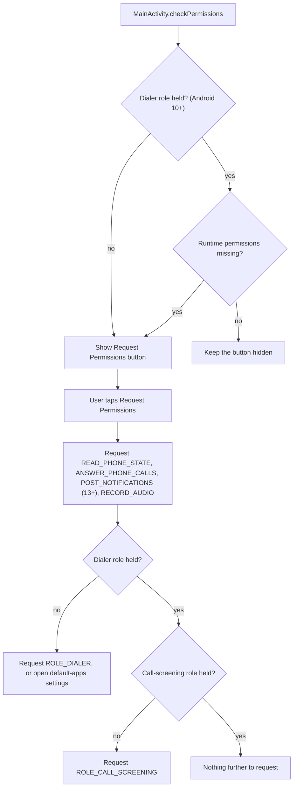
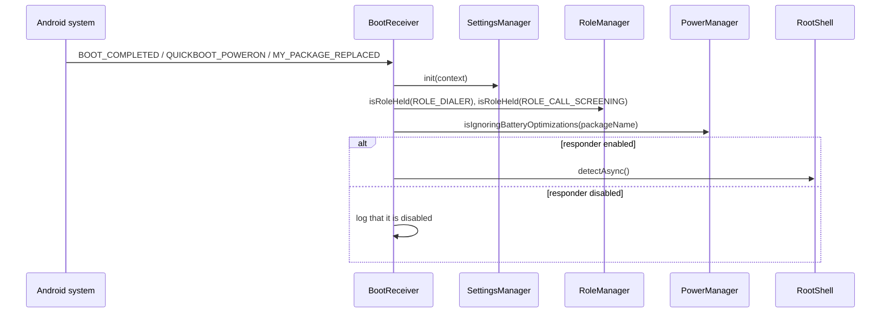

# Flow: startup and readiness

## Process start

`AppLifecycleObserver` has empty `ON_START` and `ON_STOP` callbacks, so it has no behavioural effect beyond registration.

## Activity start

`MainActivity.onCreate` initialises views, wires listeners, paints the status from the current settings, and evaluates permissions to decide whether the request button is visible. `onResume` repaints the status, so returning from the settings screen reflects saved changes.

`SettingsActivity.onCreate` initialises views, loads the current settings into the controls, and wires listeners. When root state is already cached, the root status text is updated immediately.

## Role and permission readiness

## Boot and update restoration

The receiver starts no service. Telecom binds the screening and in-call services on its own when the roles survive the reboot, so the only useful work is verification and the early root detection that avoids a prompt during the first call.

## Readiness prerequisites

| Prerequisite | Needed for | Checked by |
|--------------|------------|------------|
| `ROLE_DIALER` | AutoCallInCallService binding, supported mute and route | `MainActivity`, `BootReceiver`, `PhoneStateReceiver` |
| `ROLE_CALL_SCREENING` | CallScreeningService binding | `MainActivity`, `BootReceiver` |
| `READ_PHONE_STATE` | Legacy call observation | `MainActivity` |
| `ANSWER_PHONE_CALLS` | Answering and ending calls | `MainActivity`, `CallHandlingService` |
| `RECORD_AUDIO` | Audio path during the call | `MainActivity` |
| `POST_NOTIFICATIONS` (Android 13+) | Foreground notification visibility | `MainActivity` |
| Battery-optimisation exemption | On-time scheduled answer | `BootReceiver` (reported) |

## Related documents

- [Presentation component](../components/presentation.md)
- [Call observation component](../components/call-observation.md)
- [Troubleshooting](../troubleshooting.md)